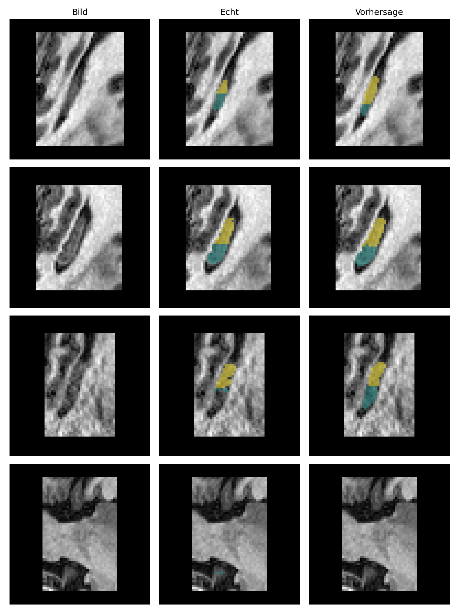
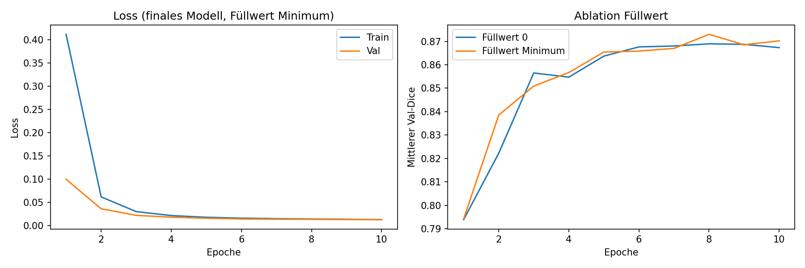

# Hippocampus Segmentation with a U-Net (PyTorch)

A small 2D U-Net, built from scratch in PyTorch, that segments the anterior and posterior hippocampus in brain MRI. The focus is on a clean, leakage-free evaluation: patient-level splits, model selection on a validation set only, and a single final run on a held-out test set.

## Result at a glance

| Held-out test set (39 patients) | Dice anterior | Dice posterior | Mean |
|---|---|---|---|
| U-Net, 117k parameters | **0.874** | **0.857** | **0.866** |

*Test slices: image, ground truth, prediction. Yellow = anterior, teal = posterior.*

## Data

- **Medical Segmentation Decathlon, Task04_Hippocampus** (CC-BY-SA 4.0), downloaded from the public AWS bucket `msd-for-monai`
- 260 labelled MRI volumes, already cropped around the hippocampus (between 31×40×24 and 43×59×47 voxels)
- Labels: 0 = background, 1 = anterior hippocampus, 2 = posterior hippocampus
- The official test volumes have no labels, so all splits are made from the 260 labelled volumes

### Split without data leakage

One file is one patient. The **list of patients** is split before anything is cut into slices, so neighbouring slices of the same brain can never end up in different sets.

| Set | Patients | 2D slices |
|---|---|---|
| Train | 182 | 6,424 |
| Validation | 39 | 1,388 |
| Test | 39 | 1,386 |

Split 70/15/15 with `random_state=42`. A set-intersection check confirms zero overlapping patients between all three sets.

## Method

**Preprocessing**
- z-score normalisation per volume (one mean and std for the whole volume, so relative intensities are preserved)
- 2D slices along axis 0
- Centred padding to 64×64 with OpenCV (`cv2.copyMakeBorder`); image padded with the volume minimum, mask padded with 0 (background)
- 38 % of training slices contain no hippocampus; they were kept, since such slices also occur at inference time

**Augmentation** (training only, each with probability 0.5)
- Random rotation of ±10° with `cv2.warpAffine`: linear interpolation for the image, nearest neighbour for the mask so labels stay 0, 1 or 2
- Random contrast (×0.9 to 1.1) and brightness (±0.1), applied after normalisation

**Model**
- 2D U-Net with two down-sampling levels: 16 → 32 → 64 channels, skip connections via concatenation
- Each block: 2 × (Conv 3×3, BatchNorm, ReLU); up-sampling with transposed convolutions; final 1×1 conv to 3 classes
- 117,427 trainable parameters (the original U-Net has about 31 million)

**Training**
- Cross-entropy loss, Adam (lr = 1e-3), batch size 32, 10 epochs, seed 42, Google Colab T4 GPU
- After each epoch: loss and per-class Dice on the validation set; the epoch with the best mean validation Dice is kept

**Metric.** Dice is computed per class, pooled over all pixels of a set. Many papers average Dice per patient instead, so the numbers here are not directly comparable to published benchmarks.

## Ablation: padding value

Does it matter whether the padded border is filled with 0 (the mean after normalisation, i.e. "average tissue") or with the volume minimum ("nothing here")? Both variants were trained from scratch with identical seed and settings and compared **on the validation set only**.

| Padding value | Best epoch | Dice anterior | Dice posterior | Mean |
|---|---|---|---|---|
| 0 | 8 | 0.877 | 0.860 | 0.869 |
| Volume minimum | 8 | 0.882 | 0.864 | **0.873** |

The difference of 0.004 is about the size of the epoch-to-epoch fluctuation, so the padding value makes practically no difference here. Following the rule "better validation score wins", the minimum variant was fixed as the final model **before** the test set was touched. The test set was then evaluated exactly once.

## Limitations

- **2D only.** The network sees one slice at a time. It misses context from neighbouring slices, which is exactly what a human uses to decide where the hippocampus ends.
- **Small structures at the edges.** On slices at the start or end of the hippocampus, with only a few labelled pixels, the model sometimes misses the structure entirely or over-segments it (see the bottom rows of the example figure).
- **Anterior/posterior boundary.** The border between the two classes is anatomically not sharp, and the predicted boundary is often shifted by a few pixels.
- **Single seed.** Each configuration was trained once. Small differences, such as in the ablation, are not statistically resolved.
- **Pooled Dice only.** No per-patient Dice and no boundary metric (e.g. Hausdorff distance) yet.
- Research and learning project, not validated for any clinical use.

## Outlook

- **2.5D input:** pass neighbouring slices as extra channels (`[3, 64, 64]` instead of `[1, 64, 64]`)
- **3D U-Net** on whole volumes
- **Dice loss** in addition to cross-entropy, so small structures weigh more
- Per-patient Dice, Hausdorff distance, and several seeds or cross-validation
- **Coarse-to-fine cascade** (first locate, then segment a crop): not useful on this already-cropped dataset, but the natural next step for full-head MRI

## Run it

1. Open `hippocampus_unet_segmentation.ipynb` in Google Colab
2. Optional: *Runtime → Change runtime type → T4 GPU* (it also runs on CPU, roughly 2–3 min per epoch)
3. *Runtime → Run all*. The notebook downloads the dataset itself.

Main libraries: PyTorch, OpenCV, NumPy, nibabel, SciPy, scikit-learn, Matplotlib. Code comments in the notebook are in German.

`best_model_min.pt` contains the weights of the final model.

## References and licence

- Antonelli, M. et al. *The Medical Segmentation Decathlon.* Nature Communications 13, 4128 (2022)
- Simpson, A. L. et al. *A large annotated medical image dataset for the development and evaluation of segmentation algorithms.* arXiv:1902.09063 (2019)
- Ronneberger, O., Fischer, P., Brox, T. *U-Net: Convolutional Networks for Biomedical Image Segmentation.* MICCAI (2015)

Dataset: CC-BY-SA 4.0 (not included in this repository). Code: MIT.

---
Khaled Abu Mustafa · M.Sc. Electrical Engineering and Information Technology, TU Darmstadt · [github.com/KhaledAbuMustafa](https://github.com/KhaledAbuMustafa)
